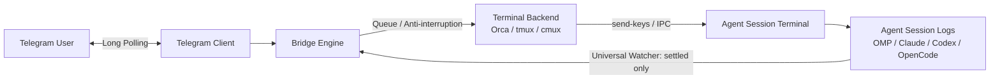

# Telegram Agent Relay

Two-way walkie-talkie connecting your Telegram chat directly to local AI coding agent sessions (**Orca, Claude Code, Codex, OpenCode, Cursor**) running inside terminal multiplexers (**Orca, tmux, cmux**).

Telegram Agent Relay receives prompts via long polling, dispatches them to your selected terminal target, watches the agent's session log stream, and relays back **only settled assistant responses** — zero streaming clutter, zero TUI repaints.

---

## ⚡ Quick Start

### 1. Prerequisites
- [Bun](https://bun.sh) **or** [Node.js](https://nodejs.org) 22.18+ (`bun --version` / `node --version`)
- A terminal multiplexer or agent runner: [Orca](https://useorca.com), `tmux`, or `cmux`
- A Telegram bot and your Telegram numeric user ID

#### 🤖 Creating a Telegram Bot (Step-by-Step)
1. On Telegram, message **[@BotFather](https://t.me/BotFather)** (check for the verified badge).
2. Send `/newbot`.
3. Choose a display name (e.g. `My Agent Walkie`).
4. Choose a unique username ending in `bot` (e.g. `my_agent_walkie_bot`).
5. BotFather will provide your **HTTP API token** (format: `1234567890:ABCdefGHIjklMNOpqrSTUvwxYZ`). Save this for your `.env`.
6. Open a conversation with your newly created bot and click **Start** (`/start`) or send `Hi`.

#### 🆔 Finding Your Chat ID / User ID
1. On Telegram, message **[@userinfobot](https://t.me/userinfobot)**.
2. Send any message or `/start`.
3. It will reply with your numeric **Id** (e.g. `383093166`).
4. In 1-on-1 private conversations with your bot, `ALLOWED_CHAT_ID` and `ALLOWED_USER_ID` share this exact value.

---

### 2. Configure Environment
Copy template and fill your credentials:

```bash
cp .env.sample .env
```

Edit `.env`:
```env
TELEGRAM_BOT_TOKEN="1234567890:ABCdefGHIjklMNOpqrSTUvwxYZ"
ALLOWED_CHAT_ID=383093166
ALLOWED_USER_ID=383093166
# Optional: defaults to "orca" (supports "orca", "tmux", "cmux")
# TERMINAL_BACKEND=orca
```

---

### 3. Run

#### Option A: Direct zero-install via npx
```bash
npx telegram-agent-relay
```
Or pass credentials directly via CLI flags:
```bash
npx telegram-agent-relay --token "<BOT_TOKEN>" --chat <CHAT_ID> --user <USER_ID>
```

#### Option B: Global install
```bash
npm install -g telegram-agent-relay
telegram-agent-relay
```

#### Option C: From source with Bun
```bash
bun run start
```

#### Option D: From source with Node (no Bun)
Node 22.18+ runs the TypeScript sources directly (built-in type stripping), no build step and no flags:
```bash
npm run start:node    # same as: node index.ts
```

#### CLI Options Reference
```bash
telegram-agent-relay [options]

  --token <token>           Telegram Bot Token (or TELEGRAM_BOT_TOKEN)
  --chat <id>               Allowed Telegram Chat ID (or ALLOWED_CHAT_ID)
  --user <id>               Allowed Telegram User ID (or ALLOWED_USER_ID)
  --backend <orca|tmux|cmux> Terminal multiplexer (default: orca)
  --target <id>             Specific target window/pane handle (optional)
  --orca-bin <path>         Orca CLI binary (default: auto-detect `orca` or `orca-ide`)
  --help, -h                Show help
  --version, -v             Show version
```
---

## 🐧 Linux & WSL Notes

Things that needed care to run on Linux and WSL (all handled automatically now):

| Problem | What the relay does |
|---|---|
| Orca's CLI is `orca` on macOS but `orca-ide` on Linux/WSL | Auto-detects whichever is on `PATH`. Override with `ORCA_BIN` or `--orca-bin`. |
| On WSL, Node's `fetch` fails with `ETIMEDOUT` against `api.telegram.org` | Node tries IPv6 and IPv4 in parallel and gives each attempt only 250 ms; WSL has no IPv6 route and the IPv4 handshake takes longer. The relay raises the per-attempt timeout to 1 s on Node (IPv6 still works where it exists). Tune with `NETWORK_FAMILY_TIMEOUT_MS`. Bun is not affected. |
| Bun can be unstable on some WSL setups | Run on Node instead (Option D above). |
| A crash left `.bridge.lock` behind and `status` kept saying "running" | The lock is released on fatal errors, and `status` checks that the PID in the lock is alive (reports stale locks). |

**Pin the target terminal.** Without `TARGET_ID`, the Orca backend picks a terminal titled `telegram`, `coordinator` or `omp`, and otherwise the *first* terminal Orca lists. That order changes as tabs open and close, so with several agent tabs open set `TARGET_ID` (see `/targets` or `orca-ide terminal list --json`) to make sure your messages reach the right session.

**Run in the background on WSL** (no launchd/systemd needed):
```bash
cd ~/projects/telegram-agent-relay
setsid nohup node index.ts > bridge.log 2> bridge.err.log < /dev/null &
node index.ts status          # Running locally: Yes
kill "$(cat .bridge.lock)"    # stop (the lock is removed on shutdown)
```

---

## 🎮 Telegram In-Chat Commands

Control the bridge behavior directly from your Telegram conversation:

| Command | Description |
|---|---|
| `/status` | View active backend, target handle/pane, listening status, and queue depth |
| `/listen` | Resume dispatching incoming Telegram prompts to the terminal |
| `/stop` | Pause dispatching (messages are held without sending to terminal) |
| `/backend <orca\|tmux\|cmux>` | Switch active terminal multiplexer on the fly |
| `/targets` | List available windows, panes, or tabs on the current backend |
| `/runs` | List active multi-agent orchestration runs (Orca backend) |
| `/tasks <run_id>` | List tasks and statuses for an orchestration run |
| `/clear` | Clear the pending message queue |
| `/help` | Show command reference |

---

## 🧠 Architecture & Zero-Noise Guarantee



1. **Native Long Polling**: No exposed webhooks, public IPs, or tunnels (e.g. ngrok/cloudflare tunnel) required.
2. **Strict Access Guard**: Only prompts originating from `ALLOWED_USER_ID` and `ALLOWED_CHAT_ID` are processed. All others are blocked.
3. **Queue & Anti-Interruption**: New messages arriving while an agent is executing are enqueued and submitted sequentially upon turn completion.
4. **Zero-Flood Settled Filter**: Responses are collected by parsing structured session logs (`stopReason: "stop"` / completed assistant turns). Progress spinners, bash tool traces, and terminal repaints are never leaked to Telegram.
5. **Single-Instance PID Lock**: File lock (`.bridge.lock`) prevents multiple processes from polling the same bot token simultaneously.
6. **Offset State Persistence**: Saves `lastUpdateId` in `state.json` across restarts.

---

## 🔄 Background Service on macOS (Launchd)

To keep Telegram Agent Relay running continuously and launch automatically on login:

1. Create `~/Library/LaunchAgents/dev.cassino.telegram-agent-relay.plist`:

```xml
<?xml version="1.0" encoding="UTF-8"?>
<!DOCTYPE plist PUBLIC "-//Apple//DTD PLIST 1.0//EN" "http://www.apple.com/DTDs/PropertyList-1.0.dtd">
<plist version="1.0">
<dict>
    <key>Label</key>
    <string>dev.cassino.telegram-agent-relay</string>
    <key>ProgramArguments</key>
    <array>
        <string>/usr/local/bin/bun</string>
        <string>run</string>
        <string>index.ts</string>
    </array>
    <key>WorkingDirectory</key>
    <string>/Users/renatocassino/projects/personal/telegram-orchestrator</string>
    <key>KeepAlive</key>
    <true/>
    <key>StandardOutPath</key>
    <string>/Users/renatocassino/projects/personal/telegram-orchestrator/bridge.log</string>
    <key>StandardErrorPath</key>
    <string>/Users/renatocassino/projects/personal/telegram-orchestrator/bridge.err.log</string>
</dict>
</plist>
```
*(Verify your bun path using `which bun`).*

2. Load the service:
```bash
launchctl load ~/Library/LaunchAgents/dev.cassino.telegram-agent-relay.plist
```

3. Unload / stop:
```bash
launchctl unload ~/Library/LaunchAgents/dev.cassino.telegram-agent-relay.plist
```

---

## 🧪 Tests

Run test suite:

```bash
bun test
```

Type check without Bun:

```bash
npm install --no-package-lock --legacy-peer-deps
npx -p typescript@5 tsc --noEmit -p .
```

## 📄 License

MIT
